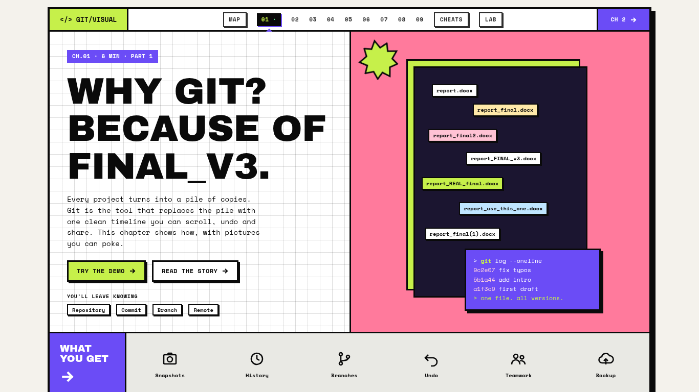
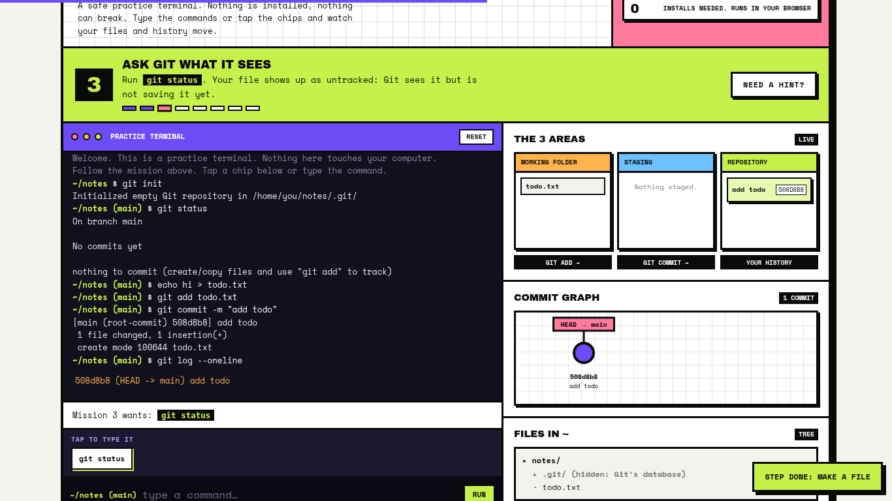
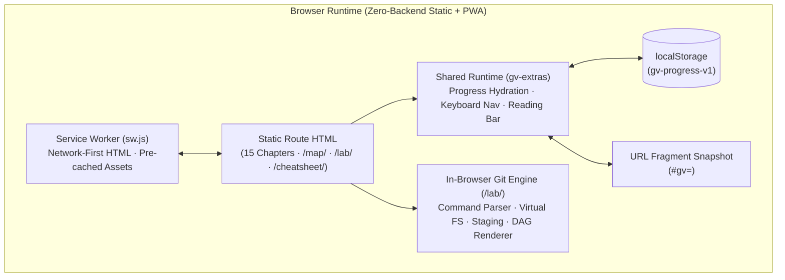

# Engineering Case Study: Git, Visually (`gg-buddy`)

**Live Product:** [git.manavdev.site](https://git.manavdev.site)  
**Category:** Interactive Developer Education · Browser-Native Sandbox · Offline-First PWA  
**Source Status:** Private production repository (this document details the system architecture, state design, representative test vectors, and automated testing pipeline).

---

## 1. Problem & Product Goal

Beginners learning Git often memorize commands (`git add .`, `git commit -m "..."`) without a mental model of how the **working directory**, **staging index**, **commit graph**, and **remote references** actually relate. Worse, running unfamiliar undo or rebase commands in a real project feels risky.

**Git, Visually** solves this by pairing spatial visual explanations with a safe, in-browser practice terminal and interactive diagnostic tools across a 15-chapter curriculum:

1. **See it before reading it:** Every chapter opens with a spatial diagram or interactive model (three-area state transitions, fast-forward vs. merge commits, `HEAD` & reflog time travel).
2. **Practice in a deterministic sandbox:** A browser-native terminal (`/lab/`) models 22 shell and Git commands while updating the working folder, staging area, and live commit DAG in real time.
3. **Recognize real failure modes:** Every lesson includes a *"When it goes wrong"* strip with real Git error messages (`fatal: not a git repository`, detached `HEAD`, non-fast-forward rejection) and plain-English fixes.

<table>
<tr>
<td width="50%"><b>Course Home (Desktop)</b><br></td>
<td width="50%"><b>Interactive Practice Terminal (<code>/lab/</code>)</b><br></td>
</tr>
</table>

---

## 2. System Architecture

The application is built with Astro and shipped as zero-backend static HTML/CSS/JS bundles with an offline-first Service Worker (`sw.js`) and a shared client runtime (`gv-extras`).



### Key Architectural Components

| Subsystem | Responsibility | Engineering Details |
| :--- | :--- | :--- |
| **In-Browser Git Sandbox (`/lab/`)** | Models 22 shell and Git commands (`init`, `status`, `add`, `commit`, `log`, `diff`, `branch`, `switch`, `merge`, `restore`, `reset`, `revert`, `reflog`, etc.) | Maintains an in-memory virtual working tree, index staging map, branch pointers, `HEAD` reference, and commit DAG. Updates 3 synchronized panels (Three Areas, Commit Graph, File Tree) on every command execution. |
| **Cross-Device Progress Portability (`/map/`)** | Transfers course progress snapshots between phone and laptop without user accounts or a database | Serializes `gv-progress-v1` into URL-safe Base64 inside the URL hash (`#gv=<payload>`). Because URL fragments are never sent over HTTP, user state stays client-side. Opening a link runs a deterministic **high-water-mark merge** (retaining the max quiz score and completion union per chapter) before stripping the hash via `history.replaceState`. |
| **Interactive Concept Replicas** | Safe simulations of OS-specific and editor traps | Includes a 16-screen clickable Git-for-Windows installer walkthrough, a `PATH` environment variable debugger, a live `.gitignore` glob matcher, and an in-browser Vim modal trap replica so beginners can practice `:wq` without getting stuck in a real terminal. |
| **Offline-First PWA (`sw.js`)** | Full offline support after initial page visit | Uses a **network-first** strategy for HTML routes (preventing stale content after deployments) with automatic fallback to cached responses when offline, alongside pre-cached self-hosted `woff2` fonts (`Archivo Black`, `Space Mono`) for zero third-party network requests. |

---

## 3. Key Engineering Decisions & Trade-offs

### 1. Teaching Model vs. Full Git Emulation (`isomorphic-git` / WASM)
- **Decision:** Build a deterministic 22-command state machine modeled directly against real Git CLI outputs rather than bundling a full filesystem + WASM Git binary.
- **Why:** Beginners in an introductory course need immediate visual feedback on how `working tree → index → local repository` transitions happen, plus structured mission hints when they type a nearly-correct command. A curated command engine keeps bundle size tiny, works instantaneously on low-end mobile devices, and allows every unsupported flag to return a pedagogical explanation rather than an opaque plumbing error.
- **Verification:** 61 distinct command sequences and output states in the practice terminal were diff-checked against real `git` CLI output.

### 2. Cross-Device Progress Portability via Shareable URL Fragments
- **Decision:** Encode a portable state snapshot in `#gv=<base64url>` instead of requiring OAuth/email sign-up.
- **Why:** Account creation is the single biggest drop-off point in free educational tools. By storing state in `localStorage` and offering a one-click *"Copy progress link"* with monotonic merge semantics:
  $$\text{mergedScore}[c] = \max(\text{localScore}[c], \text{incomingScore}[c])$$
  $$\text{mergedDone}[c] = \text{localDone}[c] \lor \text{incomingDone}[c]$$
  a learner can transfer their progress snapshot from mobile to desktop in seconds without overwriting higher scores or completed chapters already present on the destination device.

### 3. Mobile-First Terminal Input
- **Decision:** Pair standard keyboard input with contextual tap-to-type command chips on narrow viewports (`390px`).
- **Why:** Typing `git log --oneline` on a mobile virtual keyboard with autocorrect enabled is frustrating. Tap-to-type command chips make the interactive terminal usable on phones while preserving raw CLI typing on desktop.

---

## 4. Representative State & Verification Vectors

### A. Monotonic Snapshot Merge Test Vector (`gv-progress-v1`)

When a user opens `/map/#gv=<base64url>`, the client decodes the incoming payload, validates chapter keys (`1`..`15`), and merges chapter records monotonically:

```json
{
  "localBefore": {
    "v": 1,
    "ch": {
      "1": { "quiz": 100, "prac": true, "done": true },
      "2": { "quiz": 60,  "prac": false, "done": false },
      "3": { "quiz": 80,  "prac": true, "done": true }
    }
  },
  "incomingSnapshot": {
    "v": 1,
    "ch": {
      "1": { "quiz": 80,  "prac": true, "done": true },
      "2": { "quiz": 100, "prac": true, "done": true },
      "4": { "quiz": 75,  "prac": true, "done": true }
    }
  },
  "mergedAfter": {
    "v": 1,
    "ch": {
      "1": { "quiz": 100, "prac": true, "done": true },
      "2": { "quiz": 100, "prac": true, "done": true },
      "3": { "quiz": 80,  "prac": true, "done": true },
      "4": { "quiz": 75,  "prac": true, "done": true }
    }
  }
}
```

### B. Practice Terminal State Transition Vector

Each simulated command mutates the virtual repository state `(workingTree, stagingIndex, commits, branches, HEAD)` and emits CLI output verified against real Git:

| Step | Input Command | Virtual State Transition | Verified Terminal Output |
| :--- | :--- | :--- | :--- |
| 1 | `git status` *(before init)* | No state mutation (`initialized = false`) | `fatal: not a git repository (or any of the parent directories): .git` |
| 2 | `git init` | `initialized = true`, `HEAD -> refs/heads/main`, `commits = []` | `Initialized empty Git repository in /project/.git/` |
| 3 | `git add notes.txt` | Copies `workingTree["notes.txt"]` blob hash to `stagingIndex["notes.txt"]` | *(exit 0, silent output; staging panel highlights `notes.txt`)* |
| 4 | `git commit -m "first snapshot"` | Creates root commit node `c0`, advances `branches["main"] = c0` | `[main (root-commit) <short-sha>] first snapshot\n 1 file changed, ...` |
| 5 | `git restore --staged notes.txt` | Resets `stagingIndex["notes.txt"]` to `HEAD` tree version without touching `workingTree` | *(exit 0; moves modified file from Staged back to Working Folder)* |

---

## 5. Quality Assurance & Automated Verification

The repository runs automated Playwright E2E checks (`.github/workflows/e2e.yml`) and scheduled uptime verification (`.github/workflows/uptime.yml`) on every push and pull request:

- **Cross-Viewport E2E Sweep (`e2e/smoke.spec.ts`):** Drives all core routes across desktop (`1366×768`) and mobile touch (`390px`) viewports, asserting zero console errors, zero broken links/images, and zero horizontal layout overflow.
- **Accessibility Audit (`e2e/a11y.spec.ts`):** Verifies skip-to-content navigation, single-`h1` hierarchy, ARIA live regions (`role="status"` on progress toasts), keyboard chapter navigation (`ArrowLeft` / `ArrowRight`, `/` for cheat-sheet search), and full accessible labels on interactive controls.
- **Analytics Consent Isolation (`e2e/consent.spec.ts`):** Verifies that analytics scripts load only after explicit user opt-in and never block offline rendering.

---

## 6. Honest Limitations

- **Scoped command surface:** The practice terminal models 22 core shell and Git commands; advanced plumbing commands or complex interactive rebases outside the curriculum return an explicit unsupported notice.
- **Snapshot portability, not live cloud sync:** The `#gv=` progress link transfers a point-in-time snapshot between browsers rather than maintaining a continuous background cloud sync.
- **Simulated OS installers:** The Windows and macOS installer walkthroughs are interactive browser replicas labeled as illustrations rather than live virtual machines.
