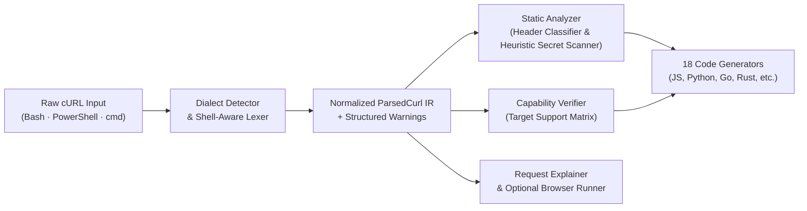

# Engineering Case Study: Toolpaper (`curl-converter`)

**Live Product:** [toolpaper.vercel.app](https://toolpaper.vercel.app/)  
**Category:** Browser-First Developer Utility · Transpiler Pipeline · Request Sanitization  
**Source Status:** Private application repository (this document details the parser architecture, intermediate representation, code generators, test vectors, and verification suite).

---

## 1. Problem & Product Goal

When developers copy network requests from browser DevTools (*"Copy as cURL"*), the resulting command is rarely ready for production code:
1. **Shell dialect differences:** Chrome/Edge on Windows emit `cmd.exe` (`^` continuations) or PowerShell (backtick continuations), while macOS/Linux emit Bash (`\` continuations and `$'...'` ANSI-C quoting).
2. **DevTools header bloat:** Browsers inject 25+ automatic headers (`sec-ch-ua*`, `sec-fetch-*`, `upgrade-insecure-requests`, session-conditional `if-none-match`) that clutter generated code and can break server-side replay.
3. **Silent flag loss in naive converters:** Most online cURL converters silently drop unsupported flags or shell interpolations (`$(...)`, `$TOKEN`), producing code that fails subtly at runtime.
4. **Accidental credential sharing:** Developers frequently paste raw cURL commands containing Bearer tokens, API keys, or session cookies into issues or share links.

**Toolpaper** is a client-side cURL workbench that parses, cleans, explains, and transpiles cURL commands across **18 language and library targets**, while surfacing explicit parser warnings and assisting with heuristic credential redaction before sharing.

---

## 2. Pipeline Architecture

All parsing, normalization, static analysis, and code generation execute 100% locally in the browser using a pure TypeScript pipeline (`src/lib/curl-parser.ts`, `src/lib/curl-cleanup.ts`, and `src/lib/capability.ts`).



### 1. Dialect Detection & Shell-Aware Tokenizer (`src/lib/curl-parser.ts`)
Instead of splitting on whitespace or regex-matching flags, the parser runs a two-stage front end:
- **Dialect detection (`detectDialect`):** Identifies PowerShell (backtick line continuations), Windows `cmd.exe` (`^` continuations), or POSIX Bash (`\` continuations).
- **Lexer (`tokenize`):** Folds dialect-specific line continuations, strips leading `$` on ANSI-C `$'...'` strings while preserving escape sequences (`\n`, `\t`, `\"`, `\\`), and handles single, double, and unquoted glued flags (such as `-XPOST` or `-HAuthorization:Bearer...`).
- **Interpolation detection:** Scans tokens for unexpanded shell variables (`$VAR`, `${VAR}`, `$(cmd)`) and emits structured `Warning` diagnostics rather than pretending to evaluate shell state.

### 2. Normalized Intermediate Representation (`ParsedCurl`)
Tokens are lowered into a strongly typed `ParsedCurl` IR:

```ts
export type ParsedCurl = {
  method: string;
  url: string;
  headers: Record<string, string>;
  body: string | null;
  form: FormField[];
  isGet: boolean;
  auth: string | null;
  authScheme: "basic" | "digest" | "ntlm" | "negotiate" | "bearer" | null;
  insecure: boolean;
  cookies: string | null;
  cookieFile: string | null;
  cookieJar: string | null;
  dialect: "bash" | "powershell" | "cmd";
  warnings: Warning[];
  followRedirects: boolean;
  compressed: boolean;
  timeoutMs: number | null;
  connectTimeoutMs: number | null;
  retries: number | null;
  httpVersion: "1.0" | "1.1" | "2" | "3" | null;
  proxy: string | null;
  failOnError: boolean;
  outputFile: string | null;
  head: boolean;
  tlsMinVersion: "1.0" | "1.1" | "2" | "3" | null;
  clientCert: string | null;
  caCert: string | null;
};
```

### 3. DevTools Header Classification & Heuristic Credential Detection (`src/lib/curl-cleanup.ts`)
Two pure static-analysis passes inspect `ParsedCurl`:
- **`analyzeNoise(parsed)`:** Classifies 25+ browser-generated headers into six categories (`client-hint`, `fetch-metadata`, `navigation`, `default`, `cache`, and `review`). Headers in `client-hint` (`sec-ch-ua*`), `fetch-metadata` (`sec-fetch-*`), `navigation`, `default`, and `cache` default to `recommendStrip: true`, whereas `origin` and `referer` are categorized as `review` (`recommendStrip: false`) so headers that may be required for server CORS/CSRF behavior are preserved unless the user explicitly removes them.
- **`analyzeSecrets(parsed)`:** Scans headers, cookies, URL query parameters, JSON body fields, and basic-auth credentials against anchored heuristic credential patterns (Bearer tokens, Stripe keys, GitHub PATs, AWS keys, Slack tokens, session cookies).
  > **Important Security Qualification:** Credential detection is heuristic and cannot guarantee identification of every sensitive value or custom token format. Users should always inspect and review requests before sharing links or pasting generated code.

### 4. Target Code Generation & Capability Matrix (`src/lib/capability.ts`)
From `ParsedCurl`, 18 dedicated target generators emit idiomatic request code:
- **JavaScript / Node.js:** `fetch`, `axios`, `ky`, Node native `fetch`
- **Python:** `requests`, `httpx`, `aiohttp`
- **Go:** `net/http`
- **Rust:** `reqwest`
- **PHP:** `ext-curl`, `Guzzle`
- **JVM / .NET / Apple:** Java `OkHttp`, Kotlin `OkHttp`, C# `HttpClient`, Swift `URLSession`
- **Shell / CLI:** PowerShell `Invoke-RestMethod`, `HTTPie`

When a parsed option (e.g., `--tlsv1.3`, `--cert`, or `--retry`) cannot be expressed natively in a given target library without custom transport boilerplate, the capability verifier emits an explicit warning or inline comment rather than silently omitting the constraint.

---

## 3. Representative Parser & Capability Test Vectors

### Vector 1: Glued Flags, `-G` Query Folding & URL Encoding
**Input cURL:**
```bash
curl -G https://api.example.com/search?existing=1 \
  -HAccept:application/json \
  --data-urlencode "q=rust & wasm" \
  -d limit=20
```
**Normalized `ParsedCurl` IR (selected fields):**
```json
{
  "method": "GET",
  "url": "https://api.example.com/search?existing=1&q=rust%20%26%20wasm&limit=20",
  "headers": { "Accept": "application/json" },
  "body": null,
  "isGet": true,
  "dialect": "bash",
  "warnings": []
}
```

### Vector 2: Shell Interpolation & Target Capability Warnings
**Input cURL:**
```bash
curl https://internal.example.com/v1/deploy \
  -H "Authorization: Bearer $DEPLOY_TOKEN" \
  --tlsv1.3 \
  --cert ./client.pem
```
**Emitted Diagnostics & Capability Checks (Target: Browser `fetch`):**
- **Parser warning (`warn`):** Unexpanded shell variable `$DEPLOY_TOKEN` detected inside double-quoted string; value will be sent literally unless replaced.
- **Capability warning (`tlsMinVersion: "3"`):** Browser `fetch` delegates TLS version negotiation to the host browser and cannot enforce `--tlsv1.3` in code.
- **Capability warning (`clientCert`):** Client certificate path `./client.pem` cannot be attached programmatically via standard browser `fetch()`.
- **Cleanup analyzer:** Flags `Authorization: Bearer ...` as a high-severity credential finding and offers one-click redaction (`Bearer <REDACTED>`).

---

## 4. Quality Assurance & Test Coverage

The core engine is verified in CI (`.github/workflows/ci.yml`) with **Vitest** unit and capability-verification test suites (`src/lib/*.test.ts`):
- **`curl-parser.test.ts`:** Tests dialect detection, ANSI-C quoting, glued short flags, `-G` query-string migration, `--data-urlencode`, multipart `-F` file/field distinction, auth schemes, and warning emission across all 18 output generators.
- **`curl-cleanup.test.ts`:** Verifies DevTools noise categorization, non-destructive `review` header preservation (`origin`/`referer`), heuristic secret detection across headers/cookies/JSON bodies, and idempotent redaction.
- **`capability.test.ts` & `capability-verification.test.ts`:** Cross-checks target capability declarations against actual generator outputs so unsupported flags are always surfaced to the user.
- **`line-diff.test.ts` & `highlight.test.ts`:** Verifies the cleanup diff viewer and Prism syntax highlighting tokenization.

---

## 5. Honest Limitations

- **Not a POSIX shell emulator:** Subshells (`$(...)`), environment variable expansions, and local filesystem reads (`-d @file.json`) are flagged with warnings rather than executed.
- **Heuristic secret scanning:** Pattern and entropy heuristics catch common credential formats but are not a substitute for manual review before sharing sensitive requests.
- **Browser `Run` panel constraints:** The optional interactive request runner uses browser `fetch()`, which is subject to CORS, browser-forbidden headers, and mixed-content restrictions.
